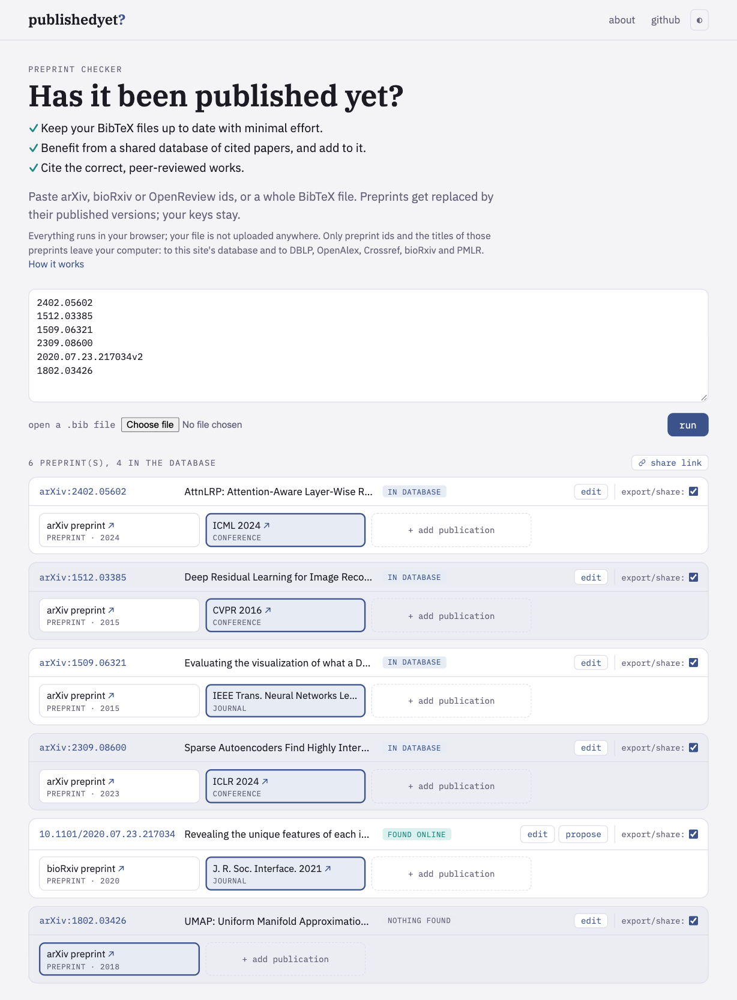

# publishedyet

Has the preprint you cite been published by now?

- Keep your BibTeX files up to date with minimal effort.
- Track a database of cited papers to give back to the community.
- Cite the correct, peer-reviewed works.

During revisions, references to arXiv or bioRxiv preprints often go stale: the paper has since
appeared in a journal or at a conference. publishedyet finds those preprints in a BibTeX file (or in a
list of ids), shows the known publications of each, and hands back a fixed BibTeX file. Replaced
entries keep their citation keys, so nothing changes in your `.tex` files, and the old entries stay in
the file as comments.

The page: <https://sebastian-lapuschkin-sideprojects.github.io/publishedyet/>

<picture>
  <source media="(prefers-color-scheme: dark)" srcset="docs/screenshot-dark.png">
  
</picture>

## How this came about

This project is largely vibe coded. Its core functionality has existed for ages, but never in a form
that could be published and shared: the first steps towards such a tool go back years and never got
far for lack of time. It has now been finished with the help of a coding agent (Claude), which wrote
most of the code while I decided what it should do and reviewed the result.

It is still deliberately a program and not an AI agent: the same input gives the same output, the
code can be read and tested, and no language model is involved when it runs. An agent asked to clean
up a bibliography can do much of the same, but less consistently.

## Your data stays with you

The page runs entirely in your browser (Python via [Pyodide](https://pyodide.org)). Your BibTeX file
is not uploaded anywhere. Only preprint ids and the titles of those preprints leave your computer: to
this site's database and to [DBLP](https://sparql.dblp.org), [OpenAlex](https://openalex.org),
[Crossref](https://www.crossref.org), the [bioRxiv API](https://api.biorxiv.org) and PMLR. So the tool is fine to use on unpublished manuscripts.

## How it works

1. **Database first.** One json file per preprint (`db/`), with the publications people have
   confirmed, each with complete BibTeX data and one marked as preferred.
2. **Online search for the rest.** For preprints not in the database, the page asks DBLP (through its
   SPARQL endpoint; it knows CS venues without DOIs, such as ICML and ICLR, and spells names right),
   OpenAlex (which often merges a preprint with its published version), searches titles in OpenAlex
   and Crossref, and asks bioRxiv, which links its preprints to their journal articles. This happens right away on every
   run, three preprints at a time. Matches found online are marked *not confirmed yet*.
3. **You choose and correct.** One card per preprint: click a publication to use it, or keep the
   preprint. "edit" shows every field of the chosen entry for correcting; "+ add publication" adds one
   by hand. Remaining preprints can be
   rewritten in one uniform style: Google Scholar, arXiv (`@misc`) or DBLP (CoRR).
4. **Export.** The chosen entries (untick "export/share" on a card to leave it out), and for a BibTeX file the fixed file plus a diff of what changed.
   Entries that were not in your file get Google Scholar style keys (`he2016deep`) or DBLP keys.
5. **Share.** "share link" copies a link that opens the page with the ticked preprints, e.g.
   `https://sebastian-lapuschkin-sideprojects.github.io/publishedyet/#2402.05602,1509.06321`
   (or `.../publishedyet/2402.05602,1509.06321`). Handy for pointing co-authors to references that
   need updating. Local edits are not part of the link; propose them for the database instead.
6. **Give back.** Confirm a match found online, correct an entry, or add a publication by hand: the
   page opens a prefilled GitHub issue (with a list of what changed, for database entries). A GitHub
   action turns it into a pull request, whose diff shows the change, for review.

Known gaps of the online search: OpenReview blocks automated requests, and DBLP only covers computer
science. Non-archival workshop papers and journal extensions with a new title are not found
automatically and need a database entry. Papers that only exist on OpenReview get ids like
`openreview:AV5BgHyVdw`.

## Command line

The same code runs locally, without anything to install beyond Python 3.9+. To try it, use the
demo bibliography in `demo/`: `demo/refs.bib` cites preprints from the database in mixed styles,
plus one published paper and one preprint without a published version. `demo/refs_fixed.bib` is
what the second command makes of it.

    python cli.py show 2402.05602 10.1101/2022.09.29.509859
    python cli.py fix demo/refs.bib -o demo/refs_fixed.bib --preprint-style scholar   # prints the diff
    python cli.py fix your.bib --online                                                 # also search online

By default it uses the `db/` folder next to it (`--db` takes another folder or the site's url + `/db`).
On the page, paste the contents of `demo/refs.bib` into the text field.

## Database format

`db/arxiv/2402/2402.05602.json` (arXiv, sharded by year and month; its full content below), `db/arxiv/hep-th/9901001.json`
(old arXiv ids), `db/doi/10.1101/2022.09.29.509859.json` (bioRxiv / medRxiv):

```json
{
  "preprint": {
    "id": "arxiv:2402.05602",
    "title": "AttnLRP: Attention-Aware Layer-Wise Relevance Propagation for Transformers",
    "authors": [
      "Reduan Achtibat",
      "Sayed Mohammad Vakilzadeh Hatefi",
      "Maximilian Dreyer",
      "Aakriti Jain",
      "Thomas Wiegand",
      "Sebastian Lapuschkin",
      "Wojciech Samek"
    ],
    "year": "2024",
    "primary_class": "cs.CL"
  },
  "publications": [
    {
      "relation": "same",
      "venue_type": "conference",
      "venue_short": "ICML",
      "archival": true,
      "dblp": "conf/icml/AchtibatHDJWLS24",
      "source": "bibtex",
      "bibtex": {
        "type": "inproceedings",
        "title": "{A}ttn{LRP}: Attention-Aware Layer-Wise Relevance Propagation for Transformers",
        "author": [
          "Achtibat, Reduan",
          "Hatefi, Sayed Mohammad Vakilzadeh",
          "Dreyer, Maximilian",
          "Jain, Aakriti",
          "Wiegand, Thomas",
          "Lapuschkin, Sebastian",
          "Samek, Wojciech"
        ],
        "booktitle": "Proceedings of the 41st International Conference on Machine Learning",
        "pages": "135--168",
        "year": "2024",
        "editor": "Salakhutdinov, Ruslan and Kolter, Zico and Heller, Katherine and Weller, Adrian and Oliver, Nuria and Scarlett, Jonathan and Berkenkamp, Felix",
        "volume": "235",
        "series": "Proceedings of Machine Learning Research",
        "month": "21--27 Jul",
        "publisher": "PMLR",
        "url": "https://proceedings.mlr.press/v235/achtibat24a.html"
      }
    }
  ]
}
```

- `relation`: `same` (the preprint as published) or `extended` (e.g. a journal extension).
- `venue_type`: `journal`, `conference`, `workshop`, `book` or `other`; `archival`: true or false.
- `preferred`: at most one publication; without it, the first one is preferred.
- `venue_short` (optional): a short name of the venue, e.g. `ICML`; shown on the page, not part of the BibTeX.
- `dblp` (optional): the DBLP key, used for DBLP style citation keys.
- `bibtex`: the entry type plus BibTeX fields; `author` is a list.

## Maintaining the database

Convention: store a publication the way its venue asks to be cited, i.e. the venue's own BibTeX
where there is one (PMLR's for ICML, AISTATS, COLT; OpenReview's for ICLR; the publisher's via its
DOI otherwise). The online search already does this for PMLR (it reads the paper's PMLR page) and
for ICLR (written from DBLP's data in OpenReview's form); other matches carry DBLP's or Crossref's data.

    python cli.py add 2402.05602 --doi 10.xxxx/yyyy        # details from Crossref
    python cli.py add 2402.05602 --bib publication.bib     # for papers without DOI
    python cli.py add 2402.05602 --doi ... --relation extended --venue-type journal --preferred
    python cli.py check
    python -m unittest discover tests

Proposals from the page arrive as issues labelled `db-proposal`. The action
(`.github/workflows/db-proposal.yml`) checks the entry, comments on the issue if something is missing,
and opens a pull request; merging it publishes the entry.

Anybody with a GitHub account can propose; the last barrier is the merge, which only people with
write access to the repository can do (the owner and the collaborators added under Settings >
Collaborators). Against a flood of spam, GitHub's interaction limits (Settings > Moderation)
restrict for a while who may open issues.

Setup once on GitHub: Pages from branch `main`, folder `/`; a label `db-proposal`; and under Settings > Actions > General, "Allow GitHub Actions to create and approve pull requests".

## Not yet

- References from PDFs (pdf.js can extract the text in the browser; arXiv ids and DOIs are easy to find,
  free-form references would need GROBID).
- Link previews / thumbnails of publications.
- Filling the database at scale.

## Files

    index.html, style.css   the page (the only JavaScript is the Pyodide loader in index.html)
    favicon.svg, *.png      the icon: the question (preprint) split from its answer (published)
    web.py                  the page's logic, in Python
    publishedyet.py         the core: reading and writing BibTeX, database lookup, online search
    cli.py                  the command line tool
    db/                     the database
    demo/                   a demo bibliography and what publishedyet makes of it
    tests/                  offline tests, with a sample BibTeX library and saved API responses
